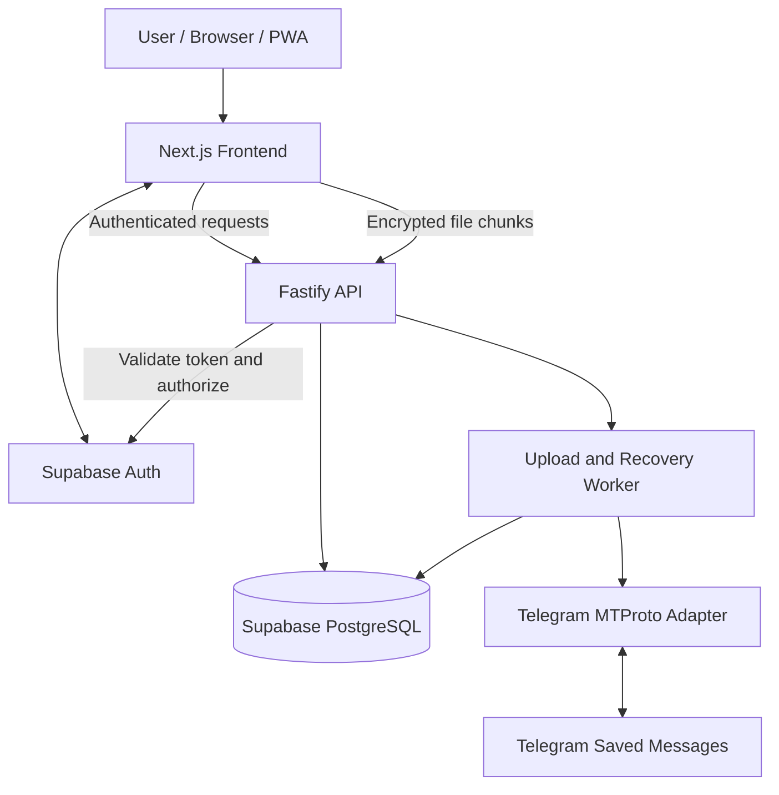
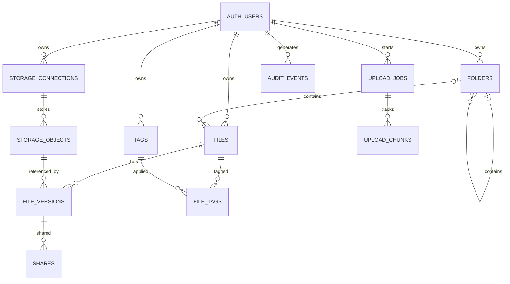

# StackBase
## Final Software Requirements Specification, Frontend Design Document, and Implementation Architecture

**Version:** 1.1  
**Date:** 25 October 2026  
**Status:** Approved implementation baseline  
**Product:** Self-hostable, personal cloud-drive web application  
**Architecture:** Modular backend API, PostgreSQL metadata, Telegram-backed storage, client-side encryption  
**Client roadmap:** PWA first; Android client later

---

# PART A — SOFTWARE REQUIREMENTS SPECIFICATION

## A1. Product scope

StackBase is an open-source personal cloud drive that allows users to upload, organize, search, preview, encrypt, version, recover, and selectively share files using their own Telegram account and Supabase project.

The product must be usable by developers who clone the repository and configure their own services. It must not depend on the original developer's accounts, credentials, or infrastructure.

### A1.1 Fixed technology decisions

| Component | Decision |
|---|---|
| Frontend | Next.js App Router, React, TypeScript |
| Styling | Tailwind CSS, shadcn/ui, Lucide |
| Backend | Fastify + TypeScript |
| API validation | TypeBox or another Fastify-compatible schema system |
| Client-side state | TanStack Query and limited Zustand |
| Authentication | Supabase Auth |
| Database | Supabase PostgreSQL |
| Database access | PostgreSQL driver and parameterized SQL; Supabase client where appropriate |
| File storage | Telegram MTProto client library |
| Telegram organization | Saved Messages |
| Encryption | Reviewed, versioned client-side cryptographic format |
| Recovery | Passphrase-derived key-encryption key protecting a random vault key |
| Local persistence | IndexedDB and supported browser file-access capabilities |
| PWA | Service worker, web app manifest, offline metadata support |
| Unit and integration tests | Vitest |
| Frontend component tests | React Testing Library |
| End-to-end tests | Playwright |
| Database authorization tests | Supabase-compatible PostgreSQL/RLS tests |
| Deployment | Independently deployable web and API services |

Use a Telegram client library with documented support for the required MTProto operations. The exact package and version must be selected and recorded in an architecture decision record before storage integration begins.

### A1.2 Product goals

1. Make file organization simple and visually attractive.
2. Provide reliable uploads with progress, retry, and recovery.
3. Encrypt content before it leaves the client.
4. Support search by filename, type, folder, date, size, and tags.
5. Preserve historical versions and support recovery.
6. Provide controlled sharing without exposing provider credentials.
7. Offer a responsive PWA with offline metadata and queued operations.
8. Provide setup documentation and automated tests suitable for an independent installation.

### A1.3 Release scope

**MVP**

- Authentication and first-run setup.
- Telegram connection.
- Encryption vault creation and recovery.
- File and folder CRUD.
- Encrypted uploads and downloads.
- Upload queue and progress.
- Retry and interruption recovery.
- Search, filtering, tags, favorites, and sorting.
- Bento dashboard.
- Image, video, audio, and PDF previews.
- Trash and restoration.
- Storage analytics.
- Light and dark themes.
- PWA installation support.
- Setup and deployment documentation.

**Post-MVP**

- Version history.
- Advanced upload reconciliation.
- Duplicate detection.
- Audit events.
- Revocable share links.
- Share expiration and download limits.
- Offline operation synchronization.
- Optional extracted-text indexing.
- Optional semantic search.

The encryption and authorization architecture must be implemented before storing sensitive user files. Advanced sharing must not ship until its key-transfer and revocation semantics have been reviewed.

## A2. Users and authorization

### A2.1 Roles

**Authenticated owner**

- Manages their own files, folders, tags, settings, storage connection, and encryption vault.
- Can create, restore, and permanently delete their own content.
- Can create and revoke shares for permitted content.

**Share recipient**

- Accesses only content explicitly granted through a share.
- Has read-only access by default.
- Can decrypt content only when they possess the necessary client-side decryption capability.

**Deployment operator**

- Configures the application and deployment.
- Can operate infrastructure but does not automatically possess user decryption keys.
- Must not receive file plaintext through ordinary backend operations.

### A2.2 Tenant isolation

Each installation may support multiple authenticated users.

Every private resource must be scoped to the authenticated owner. Each user's Telegram connection, folders, files, versions, storage objects, upload jobs, and encryption metadata must be isolated.

Do not trust a user ID supplied by the frontend. Derive the authenticated identity from the verified Supabase Auth token.

## A3. Architecture

### A3.1 Services

1. **Next.js frontend:** UI, authentication screens, client-side encryption, local metadata cache, and upload initiation.
2. **Fastify API:** authentication verification, authorization, file metadata operations, job coordination, and provider access.
3. **Telegram storage adapter:** session management, upload, message creation, download, deletion, and reconciliation.
4. **PostgreSQL:** metadata, relationships, version history, jobs, storage references, and share records.
5. **Supabase Auth:** identity and application sessions.
6. **Local persistence:** IndexedDB for metadata, upload-job state, and supported offline operations.
7. **Background worker:** resumes and reconciles persisted jobs without requiring an open browser tab.

The background worker may initially run in the Fastify process. Its job execution and persistence contracts must allow it to be separated into another worker process later.

### A3.2 Architecture diagram



### A3.3 Trust boundaries

- The browser is responsible for encrypting and decrypting file content.
- The API receives encrypted content, not plaintext content or decryption keys.
- Telegram stores encrypted payloads and provider-side message metadata.
- PostgreSQL stores server-readable organization metadata and references to Telegram messages.
- The deployment operator and database operator must not receive decryption keys through application logs, database fields, or normal API operations.
- Supabase authentication tokens are used to establish identity; they are not encryption keys.

## A4. Telegram storage contract

### A4.1 Storage organization

Use the authenticated user's Telegram Saved Messages destination as the default storage location.

Each completed logical file version is represented by one or more Telegram storage messages or provider objects, as required by the selected client implementation.

The database must maintain a stable mapping between StackBase identifiers and Telegram references.

### A4.2 Provider adapter interface

Implement a provider-independent interface similar to:

```ts
interface StorageProvider {
  checkConnection(): Promise<ConnectionStatus>;

  upload(
    input: EncryptedUploadInput
  ): Promise<StoredObjectReference>;

  download(
    reference: StoredObjectReference
  ): AsyncIterable<Uint8Array>;

  delete(
    reference: StoredObjectReference
  ): Promise<DeleteResult>;

  inspect(
    reference: StoredObjectReference
  ): Promise<StorageObjectStatus>;
}
```

Adapt the interface to the selected Telegram library. It is a domain contract, not a claim that the library exposes these exact method signatures.

The adapter must support:

- Connection validation.
- Uploading encrypted data.
- Sending the completed uploaded file to Saved Messages.
- Retrieving a stored file using persisted references.
- Recording the resulting Telegram message identifiers.
- Detecting inaccessible or missing remote objects.
- Deletion and reconciliation.
- Provider-specific rate-limit handling.

### A4.3 Upload part behavior

Telegram transfer parts are not equivalent to durable application chunks.

The adapter must:

- Follow Telegram's supported part-size and part-count constraints.
- Use provider configuration and documented library behavior.
- Limit parallel requests.
- Honor rate limits.
- Persist enough state to determine whether an upload can continue.
- Detect expired temporary upload state.
- Restart an expired provider upload safely.
- Prevent duplicate logical file creation when a provider operation is retried.

Do not promise unlimited file size, guaranteed provider-level resume, or UDP acceleration.

### A4.4 Telegram session protection

Store Telegram session material using authenticated encryption with a deployment-managed secret or key-management facility.

Never:

- Return session strings from an API endpoint.
- Put Telegram API hashes in the frontend bundle.
- Log authorization codes, passwords, or session secrets.
- Reuse one user's Telegram session for another user.
- Assume Telegram transport encryption replaces StackBase content encryption.

## A5. Upload pipeline

### A5.1 Transfer stages

Use the following logical stages:

`queued → preparing → encrypting → transferring → finalizing → completed`

Additional states:

- `paused`
- `retrying`
- `failed`
- `cancelled`
- `needs_source_file`
- `reconciliation_required`

The database state is authoritative for durable jobs. The browser may show local optimistic progress but must reconcile it with the server.

### A5.2 Browser-to-backend transfer

1. User selects a file.
2. The client validates file size and supported capabilities.
3. The client calculates a content fingerprint where practical.
4. The client encrypts the file using the versioned encryption format.
5. The client requests an upload job with an idempotency key.
6. The client transfers encrypted chunks through authenticated API requests.
7. The backend persists chunk state and safely coordinates the Telegram upload.
8. The backend finalizes the Telegram message.
9. The backend commits the file-version and storage-reference metadata.
10. The job becomes completed only after the remote object and required metadata are verified.

For large files, use streaming and bounded memory. Do not load entire files into a browser or server buffer solely to simplify implementation.

### A5.3 Idempotency

Each upload request must contain an idempotency key unique within the authenticated user's scope.

The backend must prevent repeated requests from creating multiple logical files for the same operation.

Use unique database constraints, state transitions, and reconciliation rather than relying on a client-side duplicate check.

### A5.4 Resume after refresh

The system must:

- Persist upload-job metadata.
- Persist received application-chunk state.
- Restore the queue after refresh or browser restart.
- Revalidate the authenticated user.
- Revalidate source-file availability.
- Compare a reselected file's fingerprint with the expected original fingerprint.
- Resume from confirmed recoverable state when possible.
- Restart the Telegram transfer if temporary provider parts have expired.
- Request source-file reselection when the browser can no longer access the source bytes.

The UI must distinguish actual transferred bytes from encrypted bytes prepared locally, received chunks, and finalization progress.

### A5.5 Retry policy

- Exponential backoff with jitter.
- Configurable maximum attempts for transient errors.
- Provider-directed delay for rate limits.
- No infinite retry on permanent errors.
- Explicit user retry for unrecoverable failures.
- Safe cancellation.
- Reconciliation after ambiguous provider responses.

### A5.6 Download pipeline

1. Validate identity and authorization.
2. Retrieve the version's storage reference.
3. Stream encrypted data from Telegram through the backend.
4. Validate ciphertext integrity and manifest consistency.
5. Decrypt in the client.
6. Stream or assemble the content for download or preview.
7. Release temporary buffers and object URLs.

The server must not return a permanent public storage URL as the authorization mechanism.

## A6. Encryption and recovery

### A6.1 Selected design

Use a reviewed cryptographic library supporting authenticated encryption and large-file streaming.

A suitable candidate is a maintained libsodium implementation using a reviewed streaming construction such as `crypto_secretstream_xchacha20poly1305`, with Argon2id for passphrase-based key derivation. The exact package, version, parameter profile, and interoperability test vectors must be selected and pinned before implementation.

Do not combine cryptographic primitives into a new, undocumented construction.

### A6.2 Key hierarchy

1. Generate a random vault key in the client.
2. Generate a random salt.
3. Derive a key-encryption key from the recovery passphrase using the approved KDF profile.
4. Authenticate and wrap the vault key with the derived key.
5. Generate a random data-encryption key for each file version.
6. Encrypt the file data using authenticated streaming encryption.
7. Wrap the data-encryption key under the vault key.
8. Persist the encrypted data key and versioned encryption manifest.
9. Release temporary plaintext buffers and avoid persistent plaintext copies.

Changing the recovery passphrase should allow rewrapping the vault key without requiring every file to be re-encrypted.

### A6.3 Encrypted manifest

Each file version's manifest must identify:

- Format version.
- Cipher suite.
- Chunking or streaming format.
- Nonsecret encryption parameters.
- Required nonce/header data.
- Wrapped data-encryption key.
- Ciphertext integrity information.
- Original logical file size.
- Any format-specific finalization information.

The manifest must be validated before decryption. Its format must be versioned and have test vectors.

### A6.4 Key recovery

- Never store the passphrase itself.
- Never store the derived key-encryption key in plaintext on the server.
- Verify recovery during initial setup.
- Explain that losing the passphrase and all usable recovery copies can permanently prevent decryption.
- Provide a documented recovery procedure.
- Do not silently reset or replace an inaccessible vault key.

### A6.5 Encryption acceptance tests

- Correct passphrase restores the vault key.
- Incorrect passphrase fails safely.
- Altered ciphertext fails authentication.
- Altered manifests are rejected.
- Reordered, missing, or duplicated encrypted chunks are detected.
- File downloads reproduce the original bytes.
- Multiple file versions remain independently decryptable.
- No key or passphrase appears in API payload logs, database rows, or browser error telemetry.

## A7. Sharing

### A7.1 Sharing model

Use a revocable share link referencing a specific immutable file version.

The share record contains:

- Share ID.
- Owner ID.
- File-version ID.
- Random token hash.
- Read-only permission.
- Expiration time.
- Optional download limit.
- Download count.
- Revocation timestamp.
- Optional password verifier.

### A7.2 Decryption capability

The recipient must receive the decryption capability separately from ordinary server-readable metadata.

The initial design may place a share-specific decryption secret in a URL fragment or use a secure client-mediated key-transfer flow.

The fragment must not be sent as part of the HTTP request. Sensitive routes must use strict referrer policies, no-store caching, and redacted logging.

Prefer a share-specific wrapped data key rather than exposing the vault key.

### A7.3 Revocation semantics

Revocation prevents future access through StackBase's share service. It cannot erase plaintext or keys already downloaded or copied by a recipient.

Enforce expiration, revocation, permission scope, and download limits server-side.

## A8. Functional requirements

| ID | Requirement | Priority |
|---|---|---|
| FR-01 | Supabase Auth login, logout, session restoration | P0 |
| FR-02 | Guided setup and Telegram connection | P0 |
| FR-03 | Client-side encrypted upload and download | P0 |
| FR-04 | Persistent upload queue and recovery | P0 |
| FR-05 | File/folder CRUD, move, rename, and bulk actions | P0 |
| FR-06 | Bento dashboard and file categories | P0 |
| FR-07 | Search, filtering, sorting, and tags | P0 |
| FR-08 | Image, video, audio, and PDF previews | P0 |
| FR-09 | Trash and restore | P0 |
| FR-10 | Storage insights and largest-file views | P0 |
| FR-11 | Version history and restore | P1 |
| FR-12 | Revocable encrypted sharing | P1 |
| FR-13 | Audit events | P1 |
| FR-14 | Duplicate detection | P1 |
| FR-15 | Offline metadata and queued operations | P1 |
| FR-16 | Extracted-text and semantic search | P2 |

## A9. Non-functional requirements

### Security

- HTTPS in production.
- Token validation on every protected API request.
- Server-side authorization for every resource.
- RLS and least-privilege database grants.
- No privileged credentials in browser bundles.
- Validated input schemas.
- Rate limiting.
- Secure cookie and CSRF configuration appropriate to the authentication design.
- Safe file previews and content handling.
- No secrets in logs.

### Reliability

- Durable upload-job state.
- Idempotent mutations.
- Bounded concurrency.
- Provider-aware retries.
- Cross-system reconciliation.
- Explicit error classification.
- No false success states.

### Performance

- Paginated file queries.
- Indexed filters.
- Streaming for large files.
- Bounded memory.
- Lazy-loaded previews.
- Debounced search.
- Efficient query invalidation.
- No unnecessary full-library refresh after each action.

### Accessibility

Target WCAG 2.2 AA, with keyboard navigation, visible focus, accessible status messages, sufficient contrast, reduced-motion support, and touch-friendly controls.

### Compatibility

Support current stable desktop and mobile browsers. Feature-detect offline and persistent-file-access capabilities and provide fallbacks when unavailable.

## A10. API contracts

Prefix private endpoints with `/api/v1`.

### Authentication and setup

- `GET /api/v1/me`
- `GET /api/v1/setup/status`
- `POST /api/v1/storage/telegram/authorize`
- `POST /api/v1/storage/telegram/verify`
- `POST /api/v1/storage/telegram/disconnect`

### Files and folders

- `GET /api/v1/files`
- `POST /api/v1/files`
- `GET /api/v1/files/:fileId`
- `PATCH /api/v1/files/:fileId`
- `DELETE /api/v1/files/:fileId`
- `GET /api/v1/folders`
- `POST /api/v1/folders`
- `PATCH /api/v1/folders/:folderId`
- `POST /api/v1/files/bulk`

### Uploads

- `POST /api/v1/uploads`
- `GET /api/v1/uploads/:uploadId`
- `PUT /api/v1/uploads/:uploadId/chunks/:chunkNumber`
- `POST /api/v1/uploads/:uploadId/finalize`
- `POST /api/v1/uploads/:uploadId/retry`
- `POST /api/v1/uploads/:uploadId/pause`
- `POST /api/v1/uploads/:uploadId/resume`
- `POST /api/v1/uploads/:uploadId/cancel`

The chunk endpoint must specify how each chunk is validated, acknowledged, retried, and persisted. It must not assume Telegram's temporary part store is durable.

### Downloads and search

- `GET /api/v1/files/:fileId/versions/:versionId/download`
- `GET /api/v1/search`
- `GET /api/v1/tags`
- `POST /api/v1/tags`
- `POST /api/v1/files/:fileId/tags`

### Versions and trash

- `GET /api/v1/files/:fileId/versions`
- `POST /api/v1/files/:fileId/versions/:versionId/restore`
- `GET /api/v1/trash`
- `POST /api/v1/trash/:fileId/restore`
- `DELETE /api/v1/trash/:fileId/permanent`

### Sharing

- `POST /api/v1/shares`
- `GET /api/v1/shares`
- `POST /api/v1/shares/:shareId/revoke`
- `GET /api/v1/public/shares/:token`

Every endpoint must define request and response schemas, authentication, authorization, error codes, and idempotency behavior where appropriate.

## A11. Error handling

Use stable error codes, including:

- `AUTH_REQUIRED`
- `FORBIDDEN`
- `VALIDATION_ERROR`
- `FILE_TOO_LARGE`
- `STORAGE_DISCONNECTED`
- `TELEGRAM_RATE_LIMIT`
- `TELEGRAM_SESSION_EXPIRED`
- `UPLOAD_SOURCE_REQUIRED`
- `UPLOAD_STATE_CONFLICT`
- `UPLOAD_INTEGRITY_FAILED`
- `ENCRYPTION_FAILED`
- `DECRYPTION_FAILED`
- `FILE_NOT_FOUND`
- `VERSION_NOT_FOUND`
- `SHARE_EXPIRED`
- `SHARE_REVOKED`
- `DATABASE_UNAVAILABLE`
- `STORAGE_RECONCILIATION_REQUIRED`

Responses must not reveal provider secrets, session material, stack traces, or encryption keys.

---

# PART B — DATABASE DESIGN

## B1. Database conventions

- Use UUID primary keys for logical resources.
- Use `timestamptz` for timestamps.
- Use `bigint` for file sizes and byte counts.
- Use `jsonb` only for validated, versioned structured data.
- Use explicit foreign keys and documented deletion behavior.
- Add indexes for ownership, relationships, and frequently used filters.
- Use check constraints for nonnegative sizes, valid states, and positive version numbers.
- Use database migrations for every schema change.
- Keep provider-specific storage references separate from logical file metadata.
- Keep the `current_version_id` relationship consistent with the corresponding file.
- Use soft deletion for user-visible file and folder deletion.

## B2. Required tables

### `profiles`

- `id uuid primary key references auth.users(id)`
- `display_name text`
- `avatar_url text null`
- `created_at timestamptz not null`
- `updated_at timestamptz not null`

### `user_settings`

- `user_id uuid primary key references auth.users(id)`
- `theme text not null default 'amber'`
- `default_view text not null default 'grid'`
- `default_sort text not null default 'updated_at'`
- `trash_retention_days integer not null`
- `offline_enabled boolean not null default true`
- `created_at timestamptz not null`
- `updated_at timestamptz not null`

Constrain theme and view values to supported enumerations or validated values.

### `storage_connections`

- `id uuid primary key`
- `user_id uuid not null references auth.users(id)`
- `provider text not null default 'telegram'`
- `connection_status text not null`
- `account_identifier text null`
- `encrypted_session bytea null`
- `session_key_version text null`
- `last_validated_at timestamptz null`
- `last_error_code text null`
- `created_at timestamptz not null`
- `updated_at timestamptz not null`

Use an explicit deployment-managed encryption key for session protection. If a secrets manager is used, store the secret reference instead of the session bytes. Limit the number of active connections according to the product policy.

### `folders`

- `id uuid primary key`
- `user_id uuid not null references auth.users(id)`
- `parent_folder_id uuid null`
- `name text not null`
- `created_at timestamptz not null`
- `updated_at timestamptz not null`
- `deleted_at timestamptz null`

Use a composite ownership-aware foreign key for parent folders. Validate parent cycles in the service layer and, where practical, with database constraints or a trigger. A folder cannot be its own parent or an ancestor of itself.

### `files`

- `id uuid primary key`
- `user_id uuid not null references auth.users(id)`
- `folder_id uuid null`
- `name text not null`
- `extension text null`
- `mime_type text not null`
- `logical_size_bytes bigint not null`
- `current_version_id uuid null`
- `content_fingerprint text null`
- `favorite boolean not null default false`
- `description text null`
- `created_at timestamptz not null`
- `updated_at timestamptz not null`
- `deleted_at timestamptz null`

File records represent logical files, not individual physical uploads. Do not cascade-delete remote storage objects merely because a metadata row was deleted.

### `file_versions`

- `id uuid primary key`
- `user_id uuid not null references auth.users(id)`
- `file_id uuid not null`
- `version_number integer not null`
- `size_bytes bigint not null`
- `ciphertext_hash text not null`
- `plaintext_fingerprint text null`
- `encryption_format_version text not null`
- `encryption_manifest jsonb not null`
- `storage_object_id uuid not null`
- `created_at timestamptz not null`
- `created_by uuid not null references auth.users(id)`
- `restored_from_version_id uuid null`

Constraints:

- Unique `(file_id, version_number)`.
- Positive version numbers.
- Nonnegative sizes.
- A file's current version must belong to that file and owner.
- Version content is immutable; restoration creates a new current version or otherwise preserves the full history.

### `storage_objects`

- `id uuid primary key`
- `user_id uuid not null references auth.users(id)`
- `storage_connection_id uuid not null`
- `provider text not null default 'telegram'`
- `telegram_chat_reference text not null`
- `telegram_message_reference text not null`
- `telegram_media_reference jsonb null`
- `remote_size_bytes bigint null`
- `ciphertext_hash text null`
- `storage_status text not null`
- `created_at timestamptz not null`
- `last_verified_at timestamptz null`

Use a provider-specific reference structure with a documented schema. Ensure references cannot be attached across different owners or storage connections.

### `tags`

- `id uuid primary key`
- `user_id uuid not null references auth.users(id)`
- `name text not null`
- `color_token text null`
- `created_at timestamptz not null`

Use a documented case-insensitive uniqueness policy, for example a unique index on `(user_id, lower(name))`.

### `file_tags`

- `user_id uuid not null`
- `file_id uuid not null`
- `tag_id uuid not null`
- `created_at timestamptz not null`
- Primary key `(file_id, tag_id)`

Ensure the file and tag belong to the same user using ownership-aware constraints or a transactionally enforced service rule.

### `upload_jobs`

- `id uuid primary key`
- `user_id uuid not null references auth.users(id)`
- `file_id uuid null`
- `storage_connection_id uuid not null`
- `idempotency_key text not null`
- `status text not null`
- `source_size_bytes bigint not null`
- `source_fingerprint text null`
- `encrypted_size_bytes bigint null`
- `chunk_size_bytes integer not null`
- `total_chunks integer null`
- `received_chunks integer not null default 0`
- `retry_count integer not null default 0`
- `lease_owner text null`
- `lease_expires_at timestamptz null`
- `last_error_code text null`
- `created_at timestamptz not null`
- `updated_at timestamptz not null`
- `completed_at timestamptz null`
- `cancelled_at timestamptz null`

Use a unique constraint on `(user_id, idempotency_key)`. The worker must use leases or an equivalent claim mechanism to prevent two workers from finalizing the same job simultaneously.

### `upload_chunks`

- `id uuid primary key`
- `upload_job_id uuid not null`
- `chunk_number integer not null`
- `chunk_size_bytes integer not null`
- `checksum text not null`
- `chunk_state text not null`
- `received_at timestamptz null`
- `created_at timestamptz not null`

Use unique `(upload_job_id, chunk_number)`.

Chunk persistence must be implemented deliberately. Do not store large binary payloads in ordinary metadata rows by default. If reliable server-side resumption requires durable staging, choose an explicit staging mechanism with quotas, access control, cleanup, and encryption. Its storage requirements must be documented. Telegram's temporary upload-part storage must not be treated as durable staging.

### `shares`

- `id uuid primary key`
- `user_id uuid not null references auth.users(id)`
- `file_version_id uuid not null`
- `token_hash text not null unique`
- `permission text not null default 'read'`
- `expires_at timestamptz null`
- `max_downloads integer null`
- `download_count integer not null default 0`
- `password_verifier text null`
- `revoked_at timestamptz null`
- `created_at timestamptz not null`

Share downloads must validate ownership-independent share authorization, expiry, revocation, and limits. Download-limit updates must be atomic.

### `audit_events`

- `id uuid primary key`
- `user_id uuid not null references auth.users(id)`
- `event_type text not null`
- `resource_type text null`
- `resource_id uuid null`
- `result text not null`
- `event_metadata jsonb not null default '{}'`
- `created_at timestamptz not null`

Restrict write access. Never record raw tokens, passwords, encryption keys, plaintext content, or Telegram session strings.

### `offline_operations`

- `id uuid primary key`
- `user_id uuid not null references auth.users(id)`
- `operation_type text not null`
- `resource_id uuid null`
- `payload jsonb not null`
- `base_version text null`
- `status text not null`
- `created_at timestamptz not null`
- `updated_at timestamptz not null`

This table is optional in the MVP. Browser-local IndexedDB is the initial offline queue; server-side synchronization records are introduced when a specific workflow needs them.

## B3. Relationship model



The actual migration must implement ownership-aware foreign keys. The diagram is conceptual and does not replace constraints.

## B4. Indexes

Create indexes for:

- `folders(user_id, parent_folder_id, deleted_at)`
- `files(user_id, folder_id, deleted_at)`
- `files(user_id, updated_at DESC)`
- `files(user_id, created_at DESC)`
- `files(user_id, mime_type)`
- `files(user_id, logical_size_bytes DESC)`
- `files(user_id, lower(name))` or an appropriate search index
- `file_versions(file_id, version_number DESC)`
- `storage_objects(user_id, storage_connection_id)`
- `upload_jobs(user_id, status, created_at)`
- `upload_chunks(upload_job_id, chunk_number)`
- `shares(token_hash)`
- `shares(user_id, created_at DESC)`
- `audit_events(user_id, created_at DESC)`
- `file_tags(tag_id, file_id)`

Use full-text indexing only when the search behavior requires it. Add indexes based on query patterns and measured performance rather than indiscriminately indexing every field.

## B5. Transaction and consistency rules

### File creation

- Create the logical file and upload job in a database transaction where appropriate.
- Keep the file hidden from normal browsing until finalization succeeds.
- Record the remote object only after the Telegram reference is confirmed.
- Reconcile ambiguous outcomes rather than blindly repeating remote operations.

### Version creation

- A version must be immutable.
- A new version must not overwrite the old version's encrypted payload.
- The current-version pointer must reference a version belonging to the same file and owner.
- Restoring a version must preserve the prior current version.

### Deletion

- Soft deletion updates metadata only.
- Remote deletion must be a separately tracked operation.
- Permanent deletion must account for shared versions and other references.
- Failed provider deletion must be visible and retryable.
- Do not delete a remote object still referenced by retained versions or other authorized resources.

### Idempotency and concurrency

- Enforce idempotency using database uniqueness constraints.
- Use transactions for metadata consistency.
- Use worker leases, state transitions, and reconciliation for cross-system work.
- Do not hold a PostgreSQL transaction open during a long Telegram upload.
- Use optimistic concurrency or version checks for conflicting metadata changes.

## B6. Supabase authorization

All exposed user-owned tables must have RLS enabled.

For direct client access:

- Grant only necessary operations.
- Require `auth.uid() = user_id` or an equivalent ownership-aware policy.
- Validate inserts and updates with `WITH CHECK`.
- Protect foreign-key relationships from cross-user references.
- Test unauthorized reads, writes, and deletes.

For Fastify:

- Verify the access token.
- Derive the user ID from the verified identity.
- Use explicit owner-scoped queries.
- Keep service-role or database administrative credentials server-side.
- Treat RLS as defense in depth, not as a substitute for backend authorization.

Prefer keeping internal storage references, upload chunk state, Telegram session records, and privileged audit operations outside direct client access.

## B7. Migration sequence

1. `0001_profiles_settings.sql`
2. `0002_storage_connections.sql`
3. `0003_folders_files.sql`
4. `0004_storage_objects_versions.sql`
5. `0005_tags_relationships.sql`
6. `0006_upload_jobs_chunks.sql`
7. `0007_shares_audit.sql`
8. `0008_indexes_constraints.sql`
9. `0009_rls_grants_policies.sql`
10. `0010_rls_tests_and_consistency_checks.sql`

Each migration must be reproducible on a clean project. Do not use undocumented manual schema edits.

---

# PART C — FRONTEND DESIGN DOCUMENT

## C1. Design direction

StackBase uses two themes:

**Amber Minimal**

- Warm off-white background.
- White surfaces.
- Amber primary actions.
- Charcoal typography.
- Restrained borders and shadows.

**Night Mode — Graphite Terminal**

- Deep graphite background.
- Layered dark surfaces.
- Amber highlights.
- High-contrast typography.
- Restrained technical details.

The visual language combines Bento-style cards, selective glassmorphism, and short, purposeful microinteractions.

The interface must feel simple and approachable. Avoid excessive neon, terminal-like typography across the whole interface, decorative gradients on every card, and animations that delay actions.

## C2. Design tokens

Suggested initial tokens:

| Token | Amber Minimal | Graphite Terminal |
|---|---|---|
| Background | `#FAF8F4` | `#17191C` |
| Surface | `#FFFFFF` | `#202328` |
| Raised surface | `#F3EFE7` | `#292D33` |
| Primary | `#D97706` | `#F2A93B` |
| Text primary | `#29251F` | `#F1F2F4` |
| Text secondary | `#77716A` | `#A4AAB3` |
| Border | `#E8E1D6` | `#383D45` |
| Success | `#2F7D57` | `#67C59A` |
| Error | `#C2413A` | `#F07878` |

Validate contrast for all text, controls, disabled states, and focus indicators.

### Typography

- Main interface: Inter or an equivalent readable sans-serif.
- Optional display face: restrained geometric sans-serif.
- Monospace: technical identifiers and diagnostics only.
- Page titles: 28–32 px desktop, 24–28 px mobile.
- Body: 14–16 px.
- Supporting metadata: 12–13 px.

### Layout

- Desktop sidebar: approximately 240 px.
- Collapsed sidebar: approximately 72 px.
- Main content maximum width: approximately 1440 px.
- Desktop content padding: 24–32 px.
- Mobile content padding: 16 px.
- Standard control height: 40–44 px.
- Card radius: 14–20 px.

Use a 4 px base spacing scale.

### Motion

- Short hover and press transitions.
- Clear drag-and-drop feedback.
- Smooth but restrained progress updates.
- Short dialog and toast transitions.
- Reduced-motion support.
- No decorative motion that blocks interaction.

## C3. Navigation

Primary navigation:

1. Home
2. All Files
3. Recent
4. Favorites
5. Shared
6. Trash

Secondary navigation:

- Storage Insights
- Uploads
- Settings

Settings sections:

- General
- Appearance
- Account
- Telegram connection
- Encryption and recovery
- Uploads and downloads
- Storage and retention
- Sharing
- Offline and cache

## C4. Screen requirements

### Home

- Bento category cards for Images, Videos, Audio, Documents, APKs, Archives, Downloads, and Other Files.
- Storage summary.
- Recent files.
- Recent uploads.
- Largest-file insights.
- Quick upload action.

All counts and statistics must come from real backend data.

### All Files

- Grid and list views.
- Search.
- Filters.
- Sort controls.
- Breadcrumbs.
- Multi-select.
- Bulk move, tag, favorite, and delete.
- Context menu.
- Pagination or virtualized lists.

### File preview

- Image viewer.
- Video player.
- Audio player.
- PDF preview.
- Generic unsupported-file view.
- File properties.
- Download.
- Rename, move, favorite, and version-history actions.

Never execute an uploaded file. Preview content must be treated as untrusted.

### Upload manager

- Filename.
- File size.
- Upload stage.
- Progress.
- Transfer speed when measurable.
- Retry, resume, and cancel actions.
- Source-file reselection when needed.
- Error details and recovery instructions.

Keep the queue accessible across navigation.

### Search and command palette

- Global search.
- Search by filename, type, folder, size, date, and tag.
- `Ctrl/Cmd + K` command palette.
- Keyboard navigation.
- Escape to close.
- Commands for upload, folder creation, navigation, and theme switching.

### Storage insights

- Logical file size.
- File counts.
- Category distribution.
- Largest files.
- Largest folders.
- Duplicate candidates.
- Version and Trash usage.

Explain that logical size may differ from physical provider storage consumption.

### Versions and Trash

- Version numbers and timestamps.
- Preview or download historical versions.
- Restore previous versions.
- Show deletion date and retention status.
- Confirm permanent deletion.

### Share management

- Link status.
- File-version scope.
- Expiration.
- Permission.
- Download limits.
- Password-protection status.
- Revoke action.

Clearly explain that revocation cannot erase copies already downloaded.

### Settings

- Account.
- Theme.
- Default view.
- Telegram connection health.
- Encryption vault status.
- Recovery setup.
- Upload concurrency.
- Retention.
- Share defaults.
- Offline cache.
- Nonsecret diagnostics.

Do not display Telegram session secrets or privileged database credentials.

## C5. Component inventory

Implement reusable components:

- `AppShell`
- `Sidebar`
- `MobileNavigation`
- `TopBar`
- `GlobalSearch`
- `CommandPalette`
- `BentoCard`
- `CategoryCard`
- `FileGrid`
- `FileList`
- `FileCard`
- `FileRow`
- `FilePreview`
- `FilePropertiesPanel`
- `Breadcrumbs`
- `FilterPanel`
- `SortMenu`
- `UploadQueue`
- `UploadProgress`
- `StorageUsageCard`
- `StorageBreakdownChart`
- `VersionHistory`
- `TrashList`
- `ShareDialog`
- `EncryptionSetup`
- `ConnectionStatus`
- `EmptyState`
- `ErrorState`
- `SkeletonLoader`
- `Toast`
- `ConfirmDialog`
- `ContextMenu`

Each component must have typed props, clear state ownership, and accessible semantics.

## C6. Frontend architecture

Suggested structure:

```text
apps/
  web/
    src/
      app/
      components/
        ui/
        layout/
      features/
        auth/
        files/
        folders/
        uploads/
        search/
        previews/
        encryption/
        versions/
        shares/
        storage-insights/
        settings/
      lib/
        api/
        auth/
        crypto/
        storage/
        validation/
        utils/

  api/
    src/
      app.ts
      server.ts
      plugins/
      modules/
        auth/
        files/
        folders/
        uploads/
        storage/
        versions/
        shares/
        search/
        settings/
      workers/
      providers/
        telegram/
      database/
      security/
      jobs/

packages/
  contracts/
  crypto-format/
  shared-types/

supabase/
  migrations/
  tests/

docs/
  architecture/
  security/
  setup/
  api/
```

This is the target architecture. If the existing repository uses a different layout, the coding agent must inspect it first and adapt the structure without unnecessary rewrites.

## C7. State management

**Server state**

Use TanStack Query for files, folders, tags, versions, upload status, shares, and storage analytics.

**UI state**

Use local React state for local interactions and Zustand only for state shared across multiple screens, such as selected files, command palette state, or global upload presentation.

**Durable client state**

Use IndexedDB for:

- Cached metadata.
- Upload-job metadata.
- Offline operation queue.
- Supported persistent file-access references.
- Encrypted local artifacts where justified.

Do not store plaintext encryption keys in ordinary local-storage strings. Any persistent key storage must have a documented security model and account-isolation policy.

## C8. PWA and offline behavior

The PWA shall provide:

- Installable application metadata.
- App shell caching.
- Offline status.
- Cached metadata for authorized files.
- Upload queue persistence.
- Offline operation queue.
- Retry after connectivity returns.
- Synchronization status.
- Conflict visibility.

Do not cache private API responses or decrypted file content through a broad service-worker cache rule.

Use explicit cache policies. Clear or invalidate user-specific local state on logout according to the documented security model.

Offline upload recovery depends on source-file availability and browser support. When access cannot be restored, request file reselection and verify its fingerprint.

## C9. Responsive behavior

**Desktop**

- Full sidebar.
- Multi-column Bento grid.
- Rich file list.
- Side panels for properties and details.

**Tablet**

- Collapsible sidebar.
- Reduced Bento columns.
- Compact metadata.
- Drawers for filters and file properties.

**Mobile**

- Compact navigation.
- Single- or two-column category cards.
- Touch-friendly file rows.
- Full-screen or bottom-sheet previews.
- Upload queue available without returning to Home.
- No hover-only controls.

The main workflows must remain usable at narrow viewport widths.

## C10. Loading, empty, and error states

Every major data-driven screen must support:

- Loading.
- Refreshing.
- Empty library.
- Empty folder.
- Empty search results.
- No uploads.
- Upload in progress.
- Partial upload failure.
- Offline state.
- Expired session.
- Telegram disconnected.
- Vault locked.
- Permission denied.
- Failed preview.
- Failed deletion.
- Database unavailable.

Never use fabricated files or statistics in production workflows.

## C11. Accessibility

- Semantic HTML.
- Visible keyboard focus.
- Accessible labels for icon buttons.
- Proper dialog focus management.
- Accessible progress and error announcements.
- Sufficient contrast in both themes.
- Reduced-motion support.
- Practical touch targets.
- Confirmed destructive actions.
- No color-only status indicators.

---

# PART D — TESTING AND RELEASE CRITERIA

## D1. Required automated tests

### Unit tests

- Filename normalization.
- Category detection.
- Upload state transitions.
- Idempotency behavior.
- Retry and backoff.
- Encryption manifest validation.
- Share expiration.
- Folder hierarchy validation.
- Search-filter construction.

### Integration tests

- Authentication and ownership.
- RLS and grants.
- File/folder CRUD.
- Upload-job persistence.
- Telegram adapter using a mock or test account.
- Version creation and restoration.
- Trash recovery.
- Share revocation.
- Reconciliation after provider failures.

### End-to-end tests

- Register and log in.
- Complete initial setup.
- Create an encryption vault.
- Upload an encrypted file.
- Refresh during upload.
- Resume or safely restart.
- Download and decrypt.
- Preview an image or PDF.
- Search and filter.
- Create and restore a version.
- Move to Trash and restore.
- Create and revoke a share.
- Confirm unauthorized access is rejected.

### Security tests

- Cross-user access.
- Forged resource identifiers.
- Invalid encryption manifests.
- Ciphertext tampering.
- Expired and revoked links.
- Malicious filenames.
- Rate limits.
- Secret leakage.
- Missing RLS policies.
- Incorrect ownership on foreign-key relationships.

## D2. Definition of done

A release is complete only when:

- A developer can clone the repository and configure their own services.
- Database migrations work on a clean project.
- Authentication and ownership tests pass.
- File encryption and decryption work with the documented format.
- Telegram upload and retrieval work through the provider adapter.
- Integrity failures are detected.
- Duplicate logical files are prevented during retries.
- Interrupted uploads expose accurate recovery actions.
- No privileged credentials are shipped in frontend code.
- Critical workflows have automated test coverage.
- Setup, deployment, and recovery documentation are reproducible.
- No released action is a fake or inert button.
- Known limitations are documented.

---

# PART E — CODING AGENT EXECUTION PLAN

## Milestone 0 — Architecture decisions

- Select and pin the Telegram client library.
- Finalize the encryption format and test vectors.
- Define the API contract.
- Define durable staging and upload recovery.
- Finalize the database schema and ownership constraints.
- Write the threat model and architecture decision records.

**Exit criterion:** no unresolved design decision that would invalidate the storage pipeline or encryption format.

## Milestone 1 — Foundation

- Inspect the repository.
- Configure TypeScript, linting, testing, and environment validation.
- Create Next.js and Fastify applications.
- Implement Supabase Auth.
- Add database migrations and RLS tests.
- Implement the application shell and themes.

**Exit criterion:** authenticated app with tested authorization and a clean local development setup.

## Milestone 2 — Metadata and UI

- Implement files, folders, tags, favorites, and search.
- Build the Bento dashboard.
- Implement list and grid views.
- Add loading, empty, and error states.

**Exit criterion:** a fully usable metadata-backed file manager.

## Milestone 3 — Encryption and Telegram storage

- Implement the cryptographic format.
- Add recovery and vault unlocking.
- Implement the Telegram provider adapter.
- Implement encrypted uploads and downloads.
- Persist storage references.
- Add integrity checks and reconciliation.

**Exit criterion:** encrypted end-to-end file storage works with the documented format.

## Milestone 4 — Upload reliability and previews

- Add persistent upload jobs.
- Implement chunk tracking, retry, and resume.
- Add source-file reselection.
- Add image, video, audio, and PDF previews.
- Add storage insights.

**Exit criterion:** interrupted uploads recover safely and previews do not expose file contents to the server.

## Milestone 5 — Recovery and sharing

- Add version history.
- Add Trash and retention.
- Add share creation and revocation.
- Add share-specific key transfer.
- Add audit events.

**Exit criterion:** file lifecycle and sharing behavior pass security and recovery tests.

## Milestone 6 — PWA and release

- Add offline metadata.
- Add the PWA manifest and service worker.
- Add queued offline operations and conflict handling.
- Complete responsive layouts and accessibility.
- Run security, integration, and end-to-end tests.
- Validate a clean deployment.

**Exit criterion:** an independent developer can deploy and operate StackBase with their own accounts.

---

# FINAL IMPLEMENTATION RULES

1. Treat this document as the authoritative specification.
2. Inspect the existing repository before changing its structure.
3. Do not implement all milestones in one unreviewed change.
4. Use reviewed cryptographic libraries and a versioned format.
5. Never expose Telegram session material or privileged Supabase credentials.
6. Never assume a Telegram temporary upload part is durable.
7. Never report an upload as completed before finalization and verification.
8. Never trust client-supplied user IDs for authorization.
9. Never delete remote content while retained versions still reference it.
10. Never treat share revocation as erasure of previously downloaded copies.
11. Use migrations for every database change.
12. Add tests for both allowed and denied operations.
13. Preserve recoverability across provider and database failures.
14. Document any deviation from this specification.
15. At the end of each milestone, report changed files, implemented behavior, tests run, known limitations, and the next milestone's entry criteria.

**End of StackBase SRS, FDD, and Implementation Architecture — Version 1.1.**