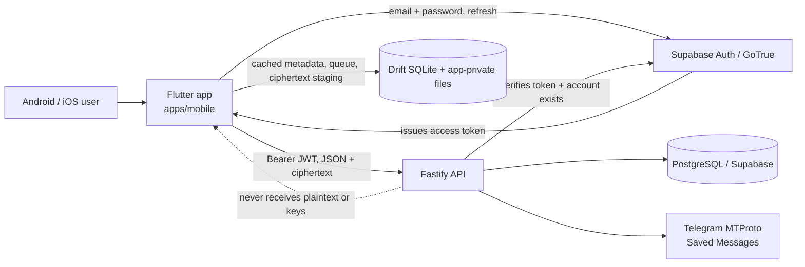

# StackBase mobile architecture — Mobile Milestone 0 decision record

**Status:** proposed for review · **Date:** 30 October 2026  
**Scope:** the Flutter client in `apps/mobile/` (Android and iOS). This record extends the
existing StackBase architecture; it does not replace the [SRS & FDD](../../SRS%20%26%20FDD.md)
or the shared [architecture decisions](../architecture/decisions.md).

The web application, Fastify API, PostgreSQL schema, Supabase Auth integration, Telegram
storage adapter and `stackbase/1` encryption format remain authoritative. Mobile is a
first-party client of those systems, not a second product.

---

## 1. Boundary and non-negotiable constraints

| Rule | Consequence for this design |
|---|---|
| One backend | The app talks only to the existing Fastify API (`/api/v1`, `/health`). No second API, no direct PostgreSQL, no direct Telegram MTProto. |
| One identity model | Access tokens come from Supabase Auth (production) or `POST /api/v1/dev/session` (development only). The API derives identity from the verified token. |
| One namespace | File, folder, tag, version, trash and share identifiers are the same ones the web app uses. Mobile changes are visible on the web and vice versa. |
| One encryption format | `stackbase/1` is implemented byte-for-byte. No Flutter-specific algorithm, manifest or key hierarchy. |
| No contract breakage | API changes are additive and documented. Existing web/API behaviour must keep its tests green. |
| Platform honesty | No claim of unrestricted filesystem access. Android scoped storage, MediaStore and SAF; iOS sandbox and document pickers. |
| No fake actions | Every button either performs a real operation or explains why it is unavailable. |

The existing web upload path is **not** reused as a design. It keeps an encryption session
only in memory and therefore cannot resume a stream after a refresh; the API reproduction
in the [Milestone 0 report](../reports/mobile-milestone-0.md#i1--cold-start-upload-resume-mixes-two-streams)
shows the resulting integrity failure. Mobile stages ciphertext on the device instead
(MADR-007), which is also why its resume path can be exact.

## 2. Verified baseline

These values were read from the repository and from the vendors' release metadata on
30 October 2026; they are not assumed from older documentation.

| Item | Verified value | Source |
|---|---|---|
| Flutter stable | **3.47.9**, Dart **3.13.7** (released 29 Oct 2026) | `releases_windows.json` from `storage.googleapis.com/flutter_infra_release` |
| Android support | API **24–37** supported; CI-tested 24–36 | [Flutter supported platforms](https://docs.flutter.dev/reference/supported-platforms) |
| Android target | `compileSdk = 36`, `targetSdk = 36`, `minSdk = 24` | Google Play requires API 36 for new apps/updates since 31 Aug 2026 |
| iOS support | iOS **15–27**; Xcode 27 builds | Flutter 3.47 supported-platforms page and release notes |
| API surface | **51 routes**: 47 authenticated, 2 public share routes, `/health`, dev session | `apps/api/src/**` route table; security sweep |
| Database | 13 migrations; no mobile-only table is required for M1–M6 | `supabase/migrations/` |
| Encryption | `stackbase/1`, libsodium secretstream + Argon2id | [encryption-format.md](../architecture/encryption-format.md) |
| Build host | Windows; Android SDK 36 present; Flutter/Dart, NDK, CMake, make and the iOS toolchain are **absent** | `flutter --version`, `java -version`, `C:/Android` |

The missing toolchain is an execution blocker, not an architecture blocker. It is listed
in the [report](../reports/mobile-milestone-0.md#14-risks-and-blockers) with the exact packages
needed before Mobile Milestone 1 can build or test native code.

## 3. System context



Only identity traffic goes to Supabase; file metadata always goes through the API. The
app never receives `service_role` credentials, `TELEGRAM_API_HASH`, session strings or the
Supabase JWT secret.

## 4. Architecture decisions

### MADR-001 — First-party Flutter client of the shared backend

**Context.** The instruction requires a native app that shares authentication, database,
file organisation, encryption and storage behaviour, without a second backend.

**Decision.** `apps/mobile/` is a Dart/Flutter application that consumes `/api/v1`
directly with a bearer token. It uses the existing `@stackbase/contracts` shapes as its
contract source of truth (verified against the actual routes, not the older SRS A10 list).
It does not connect to Telegram, PostgreSQL or Supabase's database API.

**Consequences.** The API remains the only place where ownership, storage and provider
state are decided. A mobile bug cannot bypass server authorisation, and the web and mobile
clients cannot drift into different namespaces. API additions must be versioned and
documented in [api-contract.md](api-contract.md).

### MADR-002 — Baseline: Flutter 3.47.9 / Dart 3.13.7, Android 24–36, iOS 15–27

**Context.** Several current packages already require Flutter 3.44–3.47. The Android SDK
on the build host contains platform 36 and build-tools 36.

**Decision.** Pin the mobile baseline to Flutter **3.47.9** (Dart 3.13.7). Use
`minSdk 24`, `compileSdk 36`, `targetSdk 36`. Set the iOS deployment target to **15.0**
and build with Xcode 27 on macOS. Commit `pubspec.lock`; pin direct dependencies exactly
(no carets) as the instruction requires.

**Consequences.** `pdfrx 2.11.0` requires Flutter 3.47.0, and `go_router 18.1.2`
requires 3.44, so the baseline cannot be lowered without replacing them. A developer on an older
Flutter receives a clear `pub get` failure. iOS builds cannot run on the Windows host;
they require a macOS machine with Xcode 27 and the UIScene lifecycle.

### MADR-003 — Feature-first layout, Riverpod, GoRouter, Dio, Drift, Freezed

**Context.** The instruction recommends this stack; the app has four primary areas
(Home, Local, Cloud, Settings) plus transfers.

**Decision.** Use a feature-first tree with a shared `core/`:

- `flutter_riverpod 3.4.3` for state and dependency wiring, using hand-written
  `Notifier`/`AsyncNotifier` classes rather than generated providers.
- `go_router 18.1.2` with a `StatefulShellRoute` for the bottom navigation state.
- `dio 5.11.1` for HTTP and streaming; thin repository classes per feature.
- `drift 2.35.3` + `sqlite3 3.8.0` for the on-device database; **not**
  `drift_flutter 0.3.1`, which still depends on the end-of-life
  `sqlite3_flutter_libs 0.6.0+eol` and `sqlcipher_flutter_libs 0.7.0+eol` shims.
- `freezed 4.0.3` + `json_serializable 6.15.2` for immutable DTOs/result types.
- `flutter_secure_storage 11.2.0` for session material only.

Each feature has `data/`, `domain/` (where it earns its place) and `presentation/`.
Platform code is isolated behind interfaces in `core/device/` and implemented by
Android/iOS adapters; the rest of the app never imports a platform package directly.

**Consequences.** The compiler catches contract drift inside the app; generated files are
deterministic and checked in. Riverpod providers are the only service locator, so tests
can override the API, clock, file system and database without a global singleton.

### MADR-004 — Supabase Auth with secure, per-device session storage

**Context.** The web app keeps its token in an httpOnly cookie and reaches the API through
Next route handlers. A native app has neither mechanism, and the web Supabase sign-in
screen is still absent (Milestone 6 blocker).

**Decision.** Use `supabase_flutter 2.18.3` for GoTrue only (password sign-in, refresh,
sign-out), not for database access. Pass a custom `LocalStorage` backed by
`flutter_secure_storage` so the session JSON is not stored in `shared_preferences`.
`publishableKey` is the current API name; a legacy anon key is acceptable in the same
field. The API client attaches `Authorization: Bearer <access token>`. On `401`, refresh
once through a single-flight refresher and retry the request; if refresh fails, sign the
user out and show the session-expired state. Debug builds may use the dev-auth flow
(`POST /api/v1/dev/session`) when the API reports `AUTH_MODE=dev`; release builds must
never expose that path.

**Consequences.** The mobile client can sign in before the web screen ships, but it still
needs a real Supabase project for production. Sign-out revokes the Supabase session when
reachable, always clears the local secure store, closes the account database and drops
the in-memory vault key.
The account id scopes every cache/staging path so one account can never render another's
data on the same device.

### MADR-005 — Configuration: build-time first, server-provided later

**Context.** StackBase is self-hostable. A single store binary cannot know every
deployment's API origin or Supabase project, and the app must never contain a service key.

**Decision.** For M1 use `--dart-define` values:

```text
API_BASE_URL, SUPABASE_URL, SUPABASE_PUBLISHABLE_KEY, WEB_PUBLIC_ORIGIN
```

`WEB_PUBLIC_ORIGIN` is only used to build share links (`/s/<token>#<secret>`). All are
public values. Before a distributable beta, add an unauthenticated
`GET /api/v1/client-config` that returns the same public values plus
`maxUploadBytes`/`maxActiveUploads`; the proposed shape is in
[api-contract.md](api-contract.md#g1--public-client-configuration). A runtime setup screen
can then accept only the API base URL. HTTPS is required in production; cleartext HTTP is
allowed only in debug builds for a loopback/LAN development API.

**Consequences.** M1 is not blocked on an API change, while the self-hosting story has a
documented path. No secret (JWT secret, Telegram hash, session encryption key) is ever
shipped in the app bundle or returned by the config endpoint.

### MADR-006 — Implement `stackbase/1` with sodium sumo, never a new format

**Context.** Cross-platform interoperability is mandatory. The web implementation uses
`libsodium-wrappers-sumo 0.8.4`; the format is pinned in
[encryption-format.md](../architecture/encryption-format.md).

**Decision.** Use `sodium 4.1.2+1` with the **sumo** API
(`SodiumSumoInit.init()`), which exposes `crypto_secretstream_xchacha20poly1305_*`,
`crypto_secretbox_*` and `crypto_pwhash` (Argon2id13). The package's API status table
explicitly lists `crypto_hash_sha` as not implemented; use `crypto 3.0.8`'s streaming
SHA-256 (`sha256.startChunkedConversion`) for the ciphertext hash and plaintext
fingerprint. SHA-256 is a standard algorithm and produces the same bytes as libsodium's
implementation. Use canonical base64 for every manifest field, the pinned 24-byte stream
header, 17-byte per-chunk overhead and 1 MiB default chunks.

Run Argon2id (64 MiB, ops=3) away from the UI isolate and treat 64 MiB as a device
compatibility check, not a free operation. Keep the vault key in memory only; lock it on
explicit lock, on sign-out and after a configurable idle period. Never write the
passphrase or vault key to Drift, Keychain, logs or crash reports.

**Consequences.** The same ciphertext is readable on both platforms. Any change that
breaks a shared vector is a format change and requires a version bump on the server and
both clients, not a quiet Flutter-only adjustment.

### MADR-007 — Encrypt to app-private staging, then upload chunks

**Context.** The server's chunk endpoint accepts ciphertext at deterministic offsets and
finalizes only after checking the whole stream hash. A secretstream cannot be resumed at
chunk N from its manifest alone; libsodium does not expose a serialisable push state.
The web client therefore cannot safely reuse a job after a refresh, as the reproduction
shows.

**Decision.** Mobile performs a **single read** of the source and writes the complete
ciphertext stream (24-byte header + chunks) to
`<app-support>/staging/<accountId>/<localJobId>.part`. During that pass it computes the
ciphertext SHA-256 and plaintext SHA-256. Only then does it create the server job with the
finished manifest and `sourceFingerprint`, and it uploads chunks by reading the staged
file at the pinned offsets. The staging file is the resume source: after process death,
`GET /api/v1/uploads` identifies the job, `POST .../retry` reopens a
`needs_source_file`/`failed` job, and only the missing chunk numbers are sent. If the
staging file was lost (user cleared storage, OS eviction), cancel the job (which removes
its unversioned placeholder file) and start a new upload after reselecting the source.

Staging contains ciphertext only, never plaintext. Check free space for source + ciphertext
before starting and fail early with an actionable message. Delete the staging file after
finalize, cancel or permanent failure.

**Consequences.** Cold-start resume is exact and does not depend on a new API endpoint.
It costs local disk space equal to the encrypted file and a one-time encryption pass
before the network transfer begins. A later optimisation may add a streaming mode for
files that exceed free space, but it must be labelled as non-resumable rather than
silently weakening recovery.

### MADR-008 — Android MediaStore/SAF and iOS sandbox/document picker only

**Context.** "Files by Google"-style access is not available to a normal third-party app.
Android scoped storage and iOS sandboxing both constrain what can be browsed and changed.

**Decision.** Android uses MediaStore/Photo Picker for media, SAF directory trees for
arbitrary documents, and app-specific storage for StackBase staging/pins. `saf_util 3.1.1`
and `saf_stream 4.0.3` provide tree listing, persisted grants and read/write streams.
Do **not** request `MANAGE_EXTERNAL_STORAGE`, `QUERY_ALL_PACKAGES` or
`REQUEST_INSTALL_PACKAGES`; do not claim full-device access. iOS exposes its own Documents
directory in Files, imports/exports through `UIDocumentPickerViewController`, and may
persist security-scoped bookmarks for user-selected locations through a thin native
module. It never scans the whole Files app.

**Consequences.** The Local tab is accurate about what it can see: media the user granted,
trees the user selected, and StackBase's own storage. Capability differences are surfaced
per platform; see [platform-capabilities.md](platform-capabilities.md).

### MADR-009 — Offline cache, pinned ciphertext and explicit conflicts

**Context.** FR-15 and the mobile instruction require offline cloud browsing, pinned
files, a durable queue and no silent overwrite.

**Decision.** Use a per-account Drift database for cached metadata, pending operations,
upload queue state and sync timestamps. Pinned cloud files are the **ciphertext** plus the
manifest in app-private storage; decryption happens only when the vault is unlocked, and
decrypted preview/temp files are deleted after use. Metadata mutations go through an
idempotent outbox; before applying one, compare the cached `updatedAt` with a fresh read.
On mismatch, present a conflict choice (keep server, keep local as a new copy, or discard)
instead of overwriting. M2–M6 use full snapshots; the incremental cursor and optimistic
concurrency headers in [api-contract.md](api-contract.md#g3--incremental-sync) are
prerequisites for M7, not for the first read-only release.

**Consequences.** Offline browsing is real cached data with a visible freshness state,
not fabricated placeholders. Some races remain until the API supports `If-Match`; the UI
must say so rather than pretend otherwise.

### MADR-010 — Background transfers: Android foreground service, honest iOS limits

**Context.** Android 15 limits `dataSync` foreground services to six hours in a 24-hour
period; iOS does not permit an arbitrary Dart upload loop to run indefinitely in the
background. The instruction requires background transfer "where the platform permits"
and visible recovery otherwise.

**Decision.** Android uses `flutter_foreground_task 11.0.3` with a `dataSync` foreground
service and a progress notification (`POST_NOTIFICATIONS` on API 33+). On timeout or
process death, the durable staging file and server job produce a visible *Resume* row.
iOS transfers run while the app is active, with a short `beginBackgroundTask` grace
period; if the platform suspends the app, the queue persists and resumes in the
foreground. Background `URLSession` downloads may be added for pinned files later, but
chunk orchestration is not promised in the background on iOS.

**Consequences.** No screen claims that an upload continues "always" on iOS. The transfer
sheet shows *Active*, *Waiting for the app*, *Paused*, *Needs attention* and *Complete*
states, and every interrupted row has a real action.

### MADR-011 — Amber Minimal / Graphite Terminal in a native shell

**Context.** The web design system is defined in the SRS and `globals.css`. The mobile
app must feel native while staying recognisably StackBase.

**Decision.** Port the exact tokens (`#FAF8F4`, `#FFFFFF`, `#D97706`, `#29251F`,
`#17191C`, `#202328`, `#F2A93B`, etc.) into a `ThemeExtension`, bundle Inter (OFL) instead
of fetching fonts at runtime, use a 4 px spacing scale and 18 px card radius. Bottom
navigation is Home / Local / Cloud / Settings; transfers are reachable from a persistent
app-bar control and a bottom sheet. Use a `NavigationRail` on wide tablets. Animations
respect `MediaQuery.disableAnimations`/reduced motion and never block interaction. Touch
targets are at least 48 dp Android / 44 pt iOS. All text/status has a non-colour cue.

**Consequences.** Mobile and web share a visual language without pretending to be a web
page. The standalone `material_ui`/`cupertino_ui` 1.0 packages are **not** adopted in M1:
Flutter 3.47 still ships the core libraries, and plugin compatibility is broader there.
The migration is tracked for release hardening before the core libraries' deprecation
matures.

### MADR-012 — Additive API evolution, contract tests on both sides

**Context.** Mobile needs a few capabilities the current API does not expose, and the
SRS A10 list is already stale relative to the implementation.

**Decision.** Treat the **running route table and TypeBox contracts** as the source of
truth. Add only backward-compatible endpoints/fields, documented in
[api-contract.md](api-contract.md): public client configuration, upload/active limits,
incremental sync cursor and optimistic concurrency. Do not change existing response
shapes or error codes; add a `CONFLICT` code rather than overloading
`UPLOAD_STATE_CONFLICT`. Keep `/api/v1` and regenerate/verify the Dart DTOs against
recorded API fixtures. No database migration is required by these client features; the
only migration risk is if sync cursors need a column, which is deferred until the API
design is accepted.

**Consequences.** Web and API tests remain the regression net. Mobile cannot silently
invent endpoints; any missing capability is recorded as a gap with a proposed contract.

## 5. Flutter folder structure

```text
apps/mobile/
├── pubspec.yaml                 # exact pins, commit pubspec.lock
├── analysis_options.yaml
├── README.md
├── android/
│   ├── app/src/main/AndroidManifest.xml
│   ├── app/src/main/kotlin/.../MainActivity.kt
│   └── app/src/main/kotlin/.../platform/    # SAF/bookmarks channels if needed
├── ios/
│   ├── Runner/Info.plist
│   ├── Runner/AppDelegate.swift
│   ├── Runner/SceneDelegate.swift           # iOS 27 UIScene lifecycle
│   └── Runner/Platform/                     # document picker/bookmarks if needed
├── lib/
│   ├── main.dart
│   ├── bootstrap.dart                       # config, Supabase, DB, error hooks
│   ├── app/
│   │   ├── app.dart
│   │   ├── router/app_router.dart
│   │   └── theme/{tokens.dart, theme.dart, motion.dart}
│   ├── core/
│   │   ├── config/app_config.dart
│   │   ├── api/{api_client.dart, dio_factory.dart, api_exception.dart,
│   │   │        auth_interceptor.dart, retry_policy.dart}
│   │   ├── auth/{auth_repository.dart, supabase_auth_repository.dart,
│   │   │        dev_auth_repository.dart, secure_session_store.dart}
│   │   ├── crypto/{sodium_service.dart, vault.dart, file_format.dart,
│   │   │           share.dart, encoding.dart, crypto_error.dart}
│   │   ├── db/{app_database.dart, tables.dart, daos/, migrations/}
│   │   ├── device/{device_file_system.dart, media_library.dart,
│   │   │           local_storage_info.dart, android_saf_file_system.dart,
│   │   │           ios_documents_file_system.dart}
│   │   ├── transfer/{staging_store.dart, encryption_worker.dart,
│   │   │            upload_worker.dart, download_worker.dart,
│   │   │            background_transfer.dart}
│   │   ├── sync/{sync_service.dart, pending_operations.dart,
│   │   │         conflict_resolver.dart}
│   │   ├── ui/{components/, layout/, feedback/, formatters.dart}
│   │   └── utils/{result.dart, logger.dart, ids.dart}
│   ├── features/
│   │   ├── auth/presentation/
│   │   ├── home/presentation/
│   │   ├── local_files/{data,domain,presentation}/
│   │   ├── cloud_files/{data,domain,presentation}/
│   │   ├── uploads/presentation/
│   │   ├── shares/{data,presentation}/
│   │   └── settings/presentation/
│   └── l10n/                                # only if a second locale is funded
├── test/
│   ├── crypto/                              # shared vectors, tamper cases
│   ├── api/                                 # DTO/contract fixtures, error mapping
│   ├── db/                                  # migrations, account scoping
│   ├── transfer/                            # queue, resume, checksums
│   └── features/                            # widget/semantics tests
├── integration_test/
│   ├── auth_flow_test.dart
│   ├── cloud_browse_test.dart
│   ├── upload_resume_test.dart
│   ├── offline_sync_test.dart
│   └── permissions_test.dart
└── tool/
    └── vectors/                             # shared JSON consumed by web + Flutter tests
```

Platform-specific code lives only under `android/`, `ios/` and the two `core/device`
adapters. The rest of the app is platform-neutral Dart.

## 6. Package baseline

Verified against pub.dev's package API on 30 October 2026. Direct versions are pinned
exactly; transitive versions are locked by `pubspec.lock`.

| Package | Version | Why | Constraint / note |
|---|---|---|---|
| Flutter SDK | 3.47.9 (Dart 3.13.7) | Baseline | Android 24–36, iOS 15–27 |
| `flutter_riverpod` | 3.4.3 | State/DI | Dart `^3.12.0` |
| `go_router` | 18.1.2 | Navigation | Flutter ≥3.44 |
| `dio` | 5.11.1 | HTTP + streaming | no Flutter constraint |
| `drift` / `drift_dev` | 2.35.3 / 2.35.2 | Local SQLite | `drift_dev` supports drift <2.36 |
| `sqlite3` | 3.8.0 | Native SQLite via build hooks | replaces EOL `sqlite3_flutter_libs` |
| `freezed` / `freezed_annotation` | 4.0.3 / 3.1.0 | Immutable models | Dart `^3.13.0` |
| `json_serializable` / `json_annotation` | 6.15.2 / 4.12.0 | JSON codecs | — |
| `build_runner` | 2.17.1 | Codegen | Dart `^3.11.0` |
| `flutter_secure_storage` | 11.2.0 | Keychain/Keystore session | — |
| `sodium` | 4.1.2+1 | libsodium sumo | Dart `^3.13.0`; build hooks; libsodium 1.0.22 |
| `crypto` | 3.0.8 | Streaming SHA-256 | `sodium` does not expose `crypto_hash_sha256` |
| `supabase_flutter` | 2.18.3 | GoTrue auth | `publishableKey` replaces deprecated `anonKey` |
| `permission_handler` | 13.0.2 | Runtime permissions | see platform matrix |
| `connectivity_plus` | 7.3.2 | Reachability | not a guarantee of API reachability |
| `flutter_local_notifications` | 22.3.3 | Transfer status | Android channel + iOS permission |
| `flutter_foreground_task` | 11.0.3 | Android dataSync service | Flutter ≥3.44 |
| `share_plus` | 13.3.1 | Native share sheet | user-initiated only |
| `file_selector` | 1.1.0 | Open/save documents | official Flutter package |
| `photo_manager` | 3.12.0 | Media library browse | permission-gated; Photo Picker preferred |
| `saf_util` / `saf_stream` | 3.1.1 / 4.0.3 | Android SAF tree + streams | Android only; Flutter ≥3.44 |
| `open_filex` | 5.0.0 | Open with another app | user-initiated |
| `video_player` | 2.14.1 | Video preview | Flutter ≥3.44 |
| `audioplayers` | 6.8.1 | Audio preview | Flutter ≥3.44 |
| `pdfrx` | 2.11.0 | PDF preview | Flutter ≥3.47 |
| `path_provider` | 2.1.6 | App directories | — |
| `path` / `mime` / `uuid` / `intl` / `collection` | 1.9.1 / 2.1.0 / 4.6.0 / 0.20.3 / 1.19.1 | Utilities | — |
| `device_info_plus` / `package_info_plus` | 13.3.0 / 10.2.2 | OS version, about | permission branching |
| `flutter_lints` | 6.0.0 | Lints | dev |
| `mocktail` | 1.0.5 | Test doubles | dev |
| `integration_test` / `flutter_test` | SDK | Tests | dev |

Deliberately rejected after verification:

| Candidate | Reason |
|---|---|
| `sqlite3_flutter_libs 0.6.0+eol` / `drift_flutter 0.3.1` | Package is EOL; `sqlite3 3.x` supplies native assets directly. |
| `flutter_sodium 0.2.0` | 2021 release, Dart `<3.0.0`; incompatible. |
| `sodium_libs 4.0.1` | Deprecated in favour of `sodium` 4 build hooks. |
| `shared_storage 0.8.1` | Dart `<3.0.0`; incompatible with 3.13. Use SAF packages or native code. |
| `http_mock_adapter 0.6.1` | Last release 2023; use a fake `HttpClientAdapter` in tests. |
| `material_ui` / `cupertino_ui` 1.0 | Too new for M1; core Material is still shipped in 3.47. Revisit at release hardening. |

## 7. Key data flows

### Upload (cloud)

1. User selects a source through SAF/document picker (or a local-media stream).
2. `EncryptionWorker` checks free space, derives a data key, wraps it with the vault key,
   initialises secretstream, and writes header + chunks to app-private staging while
   hashing plaintext and ciphertext.
3. `UploadWorker` creates the job (`POST /uploads`) with the finished manifest,
   idempotency key and source fingerprint.
4. It reads staged chunks at `ciphertextChunkOffset`, sends each with
   `x-chunk-checksum`, and updates UI progress from server `receivedChunks`.
5. Finalize declares the two hashes. On success, delete staging and invalidate the cloud
   list cache; on failure, keep staging and show the stable error code.
6. After process death, `GET /uploads` + local staging restore the row; `retry` reopens
   `needs_source_file`/`failed`, and only missing chunks are sent.

### Download / preview (cloud)

1. Read the selected version's manifest from `GET /files/:id/versions`.
2. Stream `GET .../download` to an app-private temp file, hashing while writing; verify
   `content-length`, `x-stackbase-ciphertext-hash` and the manifest hash before use.
3. Unwrap the data key with the in-memory vault key; decrypt chunk by chunk; verify the
   final tag, plaintext size and fingerprint constraints.
4. Preview from the decrypted temp file; delete on close/lock. Pinned files keep only
   ciphertext + manifest.

### Offline metadata

1. Cache folder/tag/summary/file pages per account; record `fetchedAt`.
2. Render cache immediately with a stale banner; refresh in the background when online.
3. Queue metadata mutations in an outbox with a stable idempotency key.
4. On reconnect, re-read the target's `updatedAt`, apply or surface a conflict. Never
   overwrite a newer server value silently.

## 8. Testing strategy

| Layer | Tool | Focus |
|---|---|---|
| Crypto | `flutter test` | Shared vectors, round-trip, tampering, reordering, truncation, wrong vault key, chunk arithmetic, base64 canonicality |
| API/DTO | `flutter test` + fixtures | Field names, enums, nullable fields, error envelope, 401/409/422 mapping |
| Database | Drift native tests | Migrations, per-account scoping, outbox ordering, conflict comparison |
| Transfer | Unit tests with fake clock/transport | Checksums, retry/backoff+jitter, pause/resume/retry transitions, staging loss, resume offsets |
| Widget/UI | `flutter_test` | Themes, reduced motion, semantics, 48 dp targets, empty/error/offline states |
| Android integration | `integration_test` + emulator | Real permission grant/deny, SAF picker, app kill/relaunch, foreground service |
| iOS integration | `integration_test` on macOS | Document picker, sandbox, background suspension, UIScene |
| Interop | Node + Flutter | Web encrypt → Flutter decrypt and Flutter encrypt → web decrypt using the same JSON vectors |
| API integration | Local API + test account | Real upload/download against Telegram-local provider, two-account isolation, 401/403 |

No mobile test has run yet: Flutter and the native build toolchain are absent from this
host. That is stated as a limitation, not as a pass.

## 9. Security model

- **Tokens:** access/refresh tokens in platform secure storage only; never in Drift,
  logs, analytics or crash reports. Dio redacts `authorization`.
- **Keys:** passphrase and vault key never persist; vault key is zeroized on lock,
  sign-out and idle timeout. Data keys are wrapped by the vault key and never sent in
  plaintext.
- **Content:** only ciphertext enters staging, pins, backups and network requests.
  Decrypted previews live in an app-private temp file and are deleted on close/lock.
- **Storage:** app-private directories; Android backup excludes staging/pins; iOS applies
  appropriate file protection and excludes ciphertext staging from iCloud backup where
  feasible.
- **Least privilege:** no all-files access, no installed-app enumeration, no APK install
  permission, no broad photo library permission unless the user explicitly grants it.
- **Deletion:** always confirmed; system delete/trash requests where the OS requires
  consent. No silent permanent deletion.
- **Account isolation:** per-account database/staging directories; sign-out closes and
  locks them; a second account cannot read the first account's cache.
- **Links:** share secrets live only in the URL fragment and are never logged or sent to
  the API. The app does not auto-open untrusted share links.

## 10. Known limitations and open decisions

- iOS builds and tests require macOS/Xcode 27; this Windows host cannot produce them.
- `sodium` 4 uses Dart build hooks and needs a native toolchain (CMake/MSVC on Windows,
  NDK + make for Android on Windows). Neither is installed here.
- Android background transfer is bounded by the platform's `dataSync` timeout; iOS
  background execution is not guaranteed. The UI must communicate this honestly.
- Offline conflict detection is only approximate until the API supports
  `If-Match`/`updated_at` preconditions.
- Full offline sync is a snapshot-based refresh until the incremental cursor endpoint
  exists.
- The local file manager is not a full-device file browser; see the capability matrix.
- Sharing is managed (create/list/revoke); consuming a public share link in-app is not
  required for the first release because the link opens the existing web viewer.
- The web Supabase sign-in screen remains a product-level blocker independent of mobile.

## 11. References

- [Verified mobile API contract](api-contract.md)
- [Platform capabilities and permissions](platform-capabilities.md)
- [Mobile milestone plan](milestone-plan.md)
- [Mobile Milestone 0 report](../reports/mobile-milestone-0.md)
- [Shared architecture decisions](../architecture/decisions.md)
- [Encryption format `stackbase/1`](../architecture/encryption-format.md)
- [SRS & FDD](../../SRS%20%26%20FDD.md)
